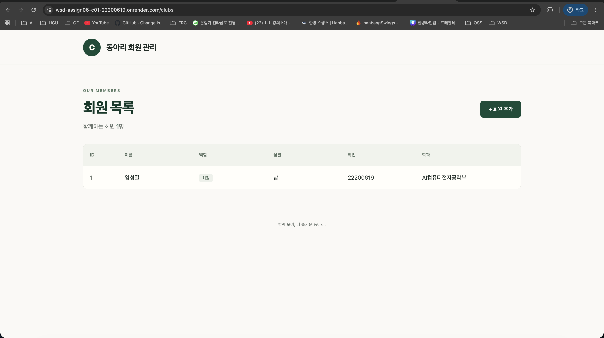
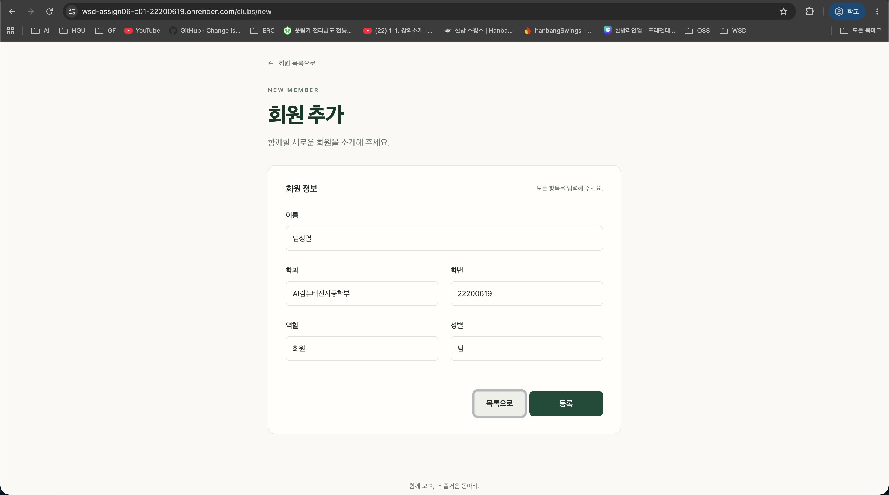

# 6주차 과제 — 동아리 회원 관리 Web UI & Form

Spring Boot CRUD 프로젝트에 Thymeleaf 와 HTML Form을 활용한 동아리 회원 관리 프로그램임.

## ① 프로젝트 소개

### 프로젝트 주제
- 동아리 회원 정보를 등록하고 조회하는 Web UI
- 기존 REST API에서 사용하던 Service와 Repository를 재사용
- 브라우저 요청을 처리하는 ClubViewController와 Thymeleaf View를 추가함.

- 관리 항목은 이름, 역할, 성별, 학번, 학과 — ID를 제외한 5개 필드
- 저장 방식은 Map<Long, Club>을 사용하는 MemoryClubRepository에서 사용함 
- 전체 회원 목록 조회, 신규 회원 등록 Form, 등록 후 목록 이동등의 기능을 구현함
- UI는 Bootstrap 5를 적용한 Table과 Form

| 필드 | 자료형 | 설명                           |
| --- | --- |------------------------------|
| `id` | `Long` | Repository에서 자동으로 생성하는 회원 ID |
| `name` | `String` | 이름                           |
| `role` | `String` | 동아리 내 역할                     |
| `gender` | `String` | 성별                           |
| `studentId` | `String` | 학번                           |
| `department` | `String` | 학과                           |

### Render 배포 URL

**배포 URL: https://wsd-assign06-c01-22200619.onrender.com/clubs**

### 프로젝트 구조

```text
sb_crud_webui/
├── Dockerfile
├── build.gradle
├── settings.gradle
├── gradlew / gradlew.bat
├── gradle/wrapper/
├── README.md
├── docs/
│   └── screenshots/
│       ├── my-member-list.png
│       └── my-member-form.png
└── src/
    ├── main/
    │   ├── java/org/example/db/sb_crud_webui/
    │   │   ├── SbCrudWebuiApplication.java
    │   │   ├── controller/
    │   │   │   ├── ClubViewController.java
    │   │   │   └── ClubController.java
    │   │   ├── service/
    │   │   │   └── ClubService.java
    │   │   ├── repository/
    │   │   │   ├── ClubRepository.java
    │   │   │   └── MemoryClubRepository.java
    │   │   ├── domain/
    │   │   │   └── Club.java
    │   │   └── dto/
    │   │       ├── ClubRequest.java
    │   │       └── ClubResponse.java
    │   └── resources/
    │       ├── application.properties
    │       ├── templates/club/
    │       │   ├── list.html
    │       │   └── form.html
    │       └── static/css/
    │           ├── bootstrap.min.css
    │           └── style.css
    └── test/java/org/example/db/sb_crud_webui/
        └── SbCrudWebuiApplicationTests.java
```

| 계층 | 역할                                                       |
| --- |----------------------------------------------------------|
| `ClubViewController` | 브라우저의 요청을 받아 Model에 데이터를 넣고 View 또는 Redirect를 반환하는 역할을 함 |
| `ClubController` | 기존 JSON CRUD API 처리                                      |
| `ClubService` | 필수 입력값 검사와 회원 등록/조회/수정/삭제 로직 처리                          |
| `ClubRepository` | 저장/조회 기능을 인터페이스로 정의                                      |
| `MemoryClubRepository` | Java Collection에 데이터를 저장하고 ID 생성                         |
| `ClubRequest` / `ClubResponse` | 요청 데이터와 응답 데이터를 전달                                       |
| Thymeleaf | Model에 담긴 데이터를 HTML로 출력                                  |


### 실행 방법

#### 1. 배포된 서비스 접속

별도의 설치 없이 브라우저에서 [Render 회원 목록 화면](https://wsd-assign06-c01-22200619.onrender.com/clubs)에 접속하면 됨.

### 주요 화면
#### 회원 목록 화면 — `GET /clubs`

ID, 이름, 역할, 성별, 학번, 학과를 Table로 표시함.
`members`를 `th:each`로 반복하고 각 필드의 값을 `th:text`로 출력함.
**회원 추가** 버튼은 `th:href`를 이용해 `/clubs/new`로 이동함.


#### 회원 등록 화면 — `GET /clubs/new`

5개 필드에 값을 입력하고 등록 버튼을 누르면 `POST /clubs`로 전송함.
각 입력란의 `name`은 `ClubRequest`의 필드명과 일치함.
**목록으로** 버튼을 누르면 등록하지 않고 목록 화면으로 돌아감.


### Web Endpoint 표

| HTTP Method | URL | 기능 |
| --- | --- | --- |
| GET | `/` | `/clubs`로 Redirect |
| GET | `/clubs` | 전체 회원 목록 조회 |
| GET | `/clubs/new` | 회원 등록 Form 표시 |
| POST | `/clubs` | 회원 등록 후 `/clubs`로 Redirect |

## ② 이번 과제 키워드

| 키워드 | 프로젝트에서의 의미 |
| --- | --- |
| @Controller | HTTP 요청을 처리하고 HTML을 만들 View 이름을 반환하는 Web Controller |
| Thymeleaf | Model의 데이터를 사용해 서버에서 HTML을 생성하는 템플릿 엔진 |
| Model | Controller에서 View로 목록과 회원 수를 전달하는 객체 |
| @ModelAttribute | Form의 요청 파라미터를 DTO 필드에 연결하는 어노테이션 |
| HTML Form | name=value 형태로 회원 정보를 서버에 전송하는 입력 화면 |
| redirect: | 브라우저에 새로운 URL로 다시 요청하도록 알리는 반환값 |
| PRG Pattern | POST → Redirect → GET 순서로 처리하여 등록 후 새로고침 시 POST 재전송을 방지하는 방식 |
| Bootstrap | Table, Form, 버튼, 반응형 배치를 구성하는 UI 프레임워크 |
| Layered Architecture | Controller, Service, Repository의 역할을 분리하는 구조 |

## ③ 핵심 내용 정리

### 1. `@Controller`와 `@RestController`의 차이

`@Controller`는 사용하는 `"club/list"` 같은 View 이름을 반환한다. `@RestController`는 반환한 회원 데이터를 JSON으로 전달함.
`@Controller`는 HTML로 결과 값이 나오게 되고, `@RestController`는 JSON으로 결과 값이 나오게 된다.
두 Controller는 응답 방식이 다르지만 같은 Service를 사용할 수 있다.

### 2. Model을 통한 데이터 전달

Controller에서 `model.addAttribute("members", clubService.findAll())`로 목록을 저장하게 되면,  View에서는 `${members}`라는 이름으로 해당 데이터에 접근한다.
따라서 Model에 저장한 이름과 HTML에서 사용하는 이름이 반드시 같아야 한다.

### 3. Thymeleaf로 Collection 출력
`th:each="member : ${members}"`는 회원 목록 수 만큼 반복하며 회원마다 HTML로 보여지는 테이블을 생성하게 된다.
각각에서는 `th:text="${member.name}"`처럼 객체의 필드 값을 출력하게 된다.

## ④ Weekly Report

### Key Learning

1. **기존 계층 재사용:** REST API에서 Web UI로 바뀌는 과정에 동일한 Service와 Repository를 사용할 수 있다.
2. **화면과 서버의 연결 규칙:** Model 이름과 Thymeleaf 변수명, Form의 name과 DTO 필드명 등등이 모두 동일하게 설정되어야 서로 연결이 된다.
3. **등록 이후의 요청 흐름:** 데이터를 저장한 뒤 Redirect하면 브라우저가 GET으로 목록을 다시 조회하며, 새로고침 시 POST 재전송을 방지하여 동일한 값의 반복이 일어나지 않토록 해야힌다.

### Web UI Flow

Browser: GET /clubs
    → ClubViewController.list(Model)
    → ClubService.findAll()
    → ClubRepository.findAll()
    → MemoryClubRepository의 Map 조회
    → 조회 결과를 Service와 Controller로 반환
    → Model에 members, memberCount 저장
    → Thymeleaf: templates/club/list.html 처리
    → 회원 목록 HTML을 Browser에 응답

Controller는 조회한 데이터를 Model에 넣고 `"club/list"`를 반환함.
Thymeleaf는 Model의 목록을 반복해서 실제 HTML Table을 만듦.

### Form Flow

Browser: GET /clubs/new
    → ClubViewController.form()
    → HTML Form 표시
    → 사용자가 5개 회원 정보를 입력하고 등록
    → POST /clubs (Form 데이터)
    → @ModelAttribute로 ClubRequest 생성 및 값 설정
    → ClubService.create(request)
    → ClubRepository.save(...)
    → MemoryClubRepository의 Map에 저장
    → return "redirect:/clubs"
    → Browser: GET /clubs
    → 등록한 회원이 포함된 목록 HTML 표시

### Problem & Solution

**문제점:** redirect를 사용하지 않아서 값이 중복으로 등록됨.

**해결 방법:** POST 요청을 처리한 뒤 화면을 직접 반환하지 않고, redirect로 GET 요청을 다시 보내도록 수정함.


### Code Review

`ClubViewController`의 등록 메서드임.

```java
@PostMapping("/clubs")
public String create(@ModelAttribute ClubRequest request) {
    clubService.create(request);
    return "redirect:/clubs";
}
```

- `@PostMapping`의 경로는 Form의 `th:action`과 일치시킴,
- `@ModelAttribute`는 입력값을 `ClubRequest`로 연결함.
- 마지막으로 Redirect를 반환하여 등록 이후의 화면 조회를 GET 요청으로 분리하여 등록시 중복이 일어나지 않도록 작성함.

### AI Usage

**AI를 활용한 부분**
- Bootstrap 기반 목록 Table과 등록 Form의 디자인 및 반응형 배치 조정
- WEB UI를 실행하는 과정에서 ViewController가 어떤 부분들을 담아야 하는지 검색

**생성된 코드를 직접 확인/수정한 부분**
- Form의 `th:action="@{/clubs}"`, `method="post"`가 Controller와 일치하는지 확인
- `name`, `role`, `gender`, `studentId`, `department`가 DTO 필드명과 일치시킴
- create 함수에서 Redirect를 사용하도록 수정함.


### Reflection
- 등록 처리 후 return "club/list"처럼 화면을 바로 반환하면 된다고 생각했다. 
- 하지만 이렇게 하면 브라우저가 현재 화면을 POST /clubs의 결과로 기억하면서 재제출 시 POST 요청이 다시 전송되어 같은 데이터가 중복 등록되는 문제가 생기게 됨으로,이를 해결하기 위해 return "redirect:/clubs"를 사용해야한다는 부분을 새롭게 알게 되었다.

### 건의사항
- 새로운 개념이 실제 코드에서는 어떻게 사용되는지에 대한 예시가 조금 더 강의 자료에 나와있으면 보다 해당 개념을 이해하는데 도움이 될 것 같습니다!